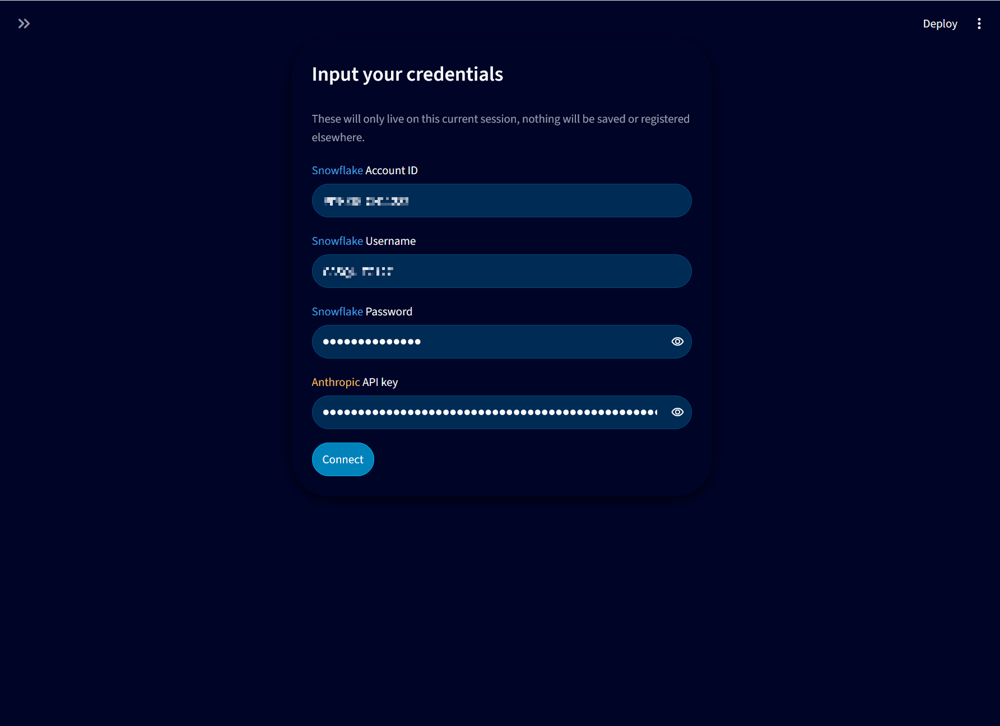
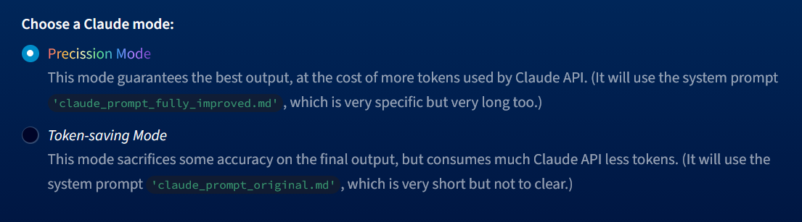
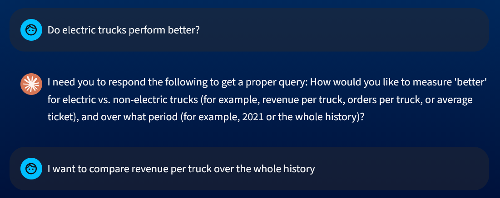
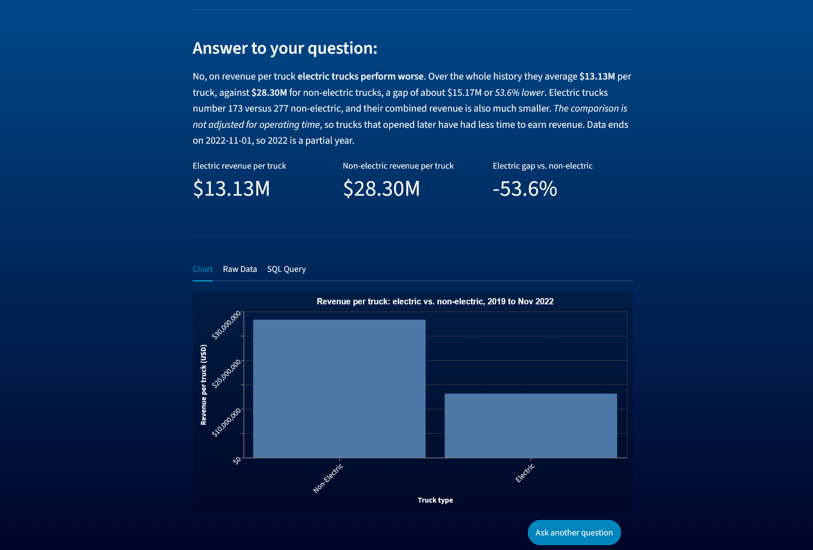
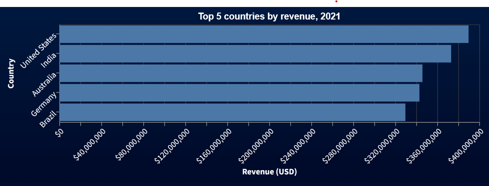
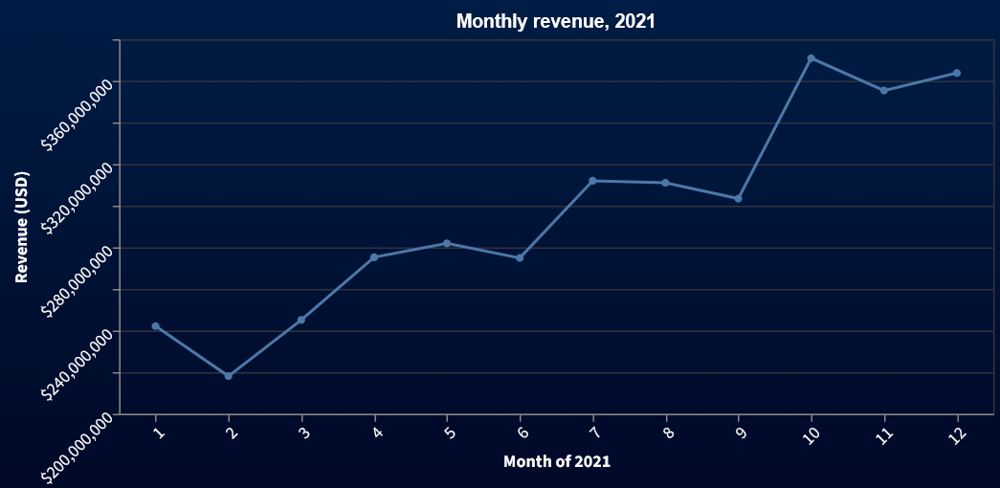
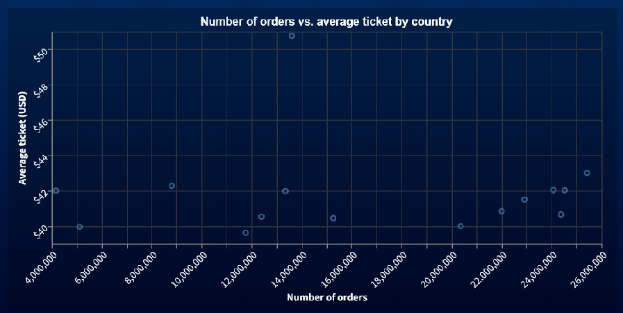
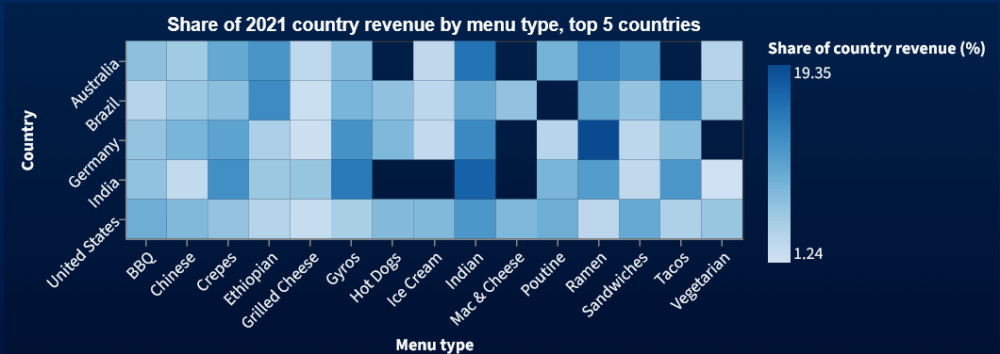

# 🚚 Chat with your Data: Tasty Bytes + Snowflake + Claude API 🍔

A conversational analytics assistant: ask a business question in plain English, and Claude turns it into Snowflake SQL, runs it on the **Tasty Bytes** food-truck dataset, and returns an auto-generated dashboard with key metrics, a chart and a written interpretation of the results.

In the following GIF, a demo of how the app should look can be seen. 

> *NOTE: The loading times have benn reduced to just 1 second, just to show the important features of the app.*

<p align="center">
  
</p>


## Objective

The app lets non-technical users get answers from a data warehouse **without writing SQL**. Behind one chat input, the app:

1. **Translates** a natural-language question into a Snowflake SQL query (text-to-SQL), based on the documentation of the database.
2. **Asks for clarification** when the question is too vague to turn into a reliable query.
3. **Runs** the query on Snowflake with a read-only role, and **fixes itself** if the query fails: Claude gets the error message and rewrites the query, with up to 2 retries.
4. **Interprets** the result: Claude computes 1–3 key metrics, chooses the right chart type and writes a short business explanation.
5. **Reports cost**: it shows the Claude API cost (USD) of each answer.


## App capabilities

### 1. Two Claude modes: precision vs. token saving

Before asking a question, the user chooses how Claude should work. Each mode loads a different system prompt, chosen after a prompt evaluation (see `notebooks/2 Snowflake and Claude API connection & Prompt Engineering.ipynb`). Each of the 3 candidate prompts was scored on output quality (with Claude as an LLM judge), SQL syntax validity (with `sqlglot`) and a logarithmic penalty on token cost:

| Mode | System prompt | Trade-off |
|---|---|---|
| **Precission Mode** | `prompts/claude_prompt_fully_improved.md` | Highest output quality, but a much longer prompt, so more tokens per question. |
| **Token-saving Mode** | `prompts/claude_prompt_original.md` | Shorter prompt and much cheaper, with slightly less accurate output. |

<p align="center">
  
</p>

### 2. Clarifying questions for vague requests

If a question can be read in several ways (e.g. *"Is the loyalty program working?"*), Claude does not guess. It asks the user what they mean first, and then builds the query from the original question plus the user's answer.

<p align="center">
  
</p>

### 3. Auto-generated dashboard

After the query runs, the app switches to a dashboard page with:

- **Answer to your question**: a written interpretation of the results.
- **Key metrics**: 1 to 3 metric cards computed by Claude.
- **Tabs**: *Chart*, *Raw Data* (the result table) and *SQL Query* (the generated query).

<p align="center">
  
</p>

Claude picks the chart type from the shape of the result (time series, rankings, relationships between measures, two categorical dimensions…). The app then renders it with Altair from a JSON specification:

| Bar chart (rankings / comparisons) | Line chart (time series) |
|:---:|:---:|
|  |  |
| **Scatter plot (relationship between two measures)** | **Heatmap (two categorical dimensions)** |
|  |  |

> If the result can't be charted in a meaningful way (e.g. a single row), the dashboard shows only the *Raw Data* and *SQL Query* tabs.


## Tools & what each one was used for

| Tool | Used for |
|---|---|
| **Snowflake** (Snowflake Notebooks / Workspace) | Hosting the Tasty Bytes database. Creating the roles (`tasty_dev` for building, `tasty_read_only` for the app, so Claude can never alter or drop objects), the warehouses (an XXXLARGE one only for loading data, then dropped; an XSMALL `TASTY_DE_WH` for queries), the external S3 stage and the data ingest with `COPY INTO`. |
| **Snowpark for Python** (`snowflake-snowpark-python`) | Connecting from Python to Snowflake and running the generated queries, returning results as pandas DataFrames. |
| **Claude API** (`anthropic` SDK, Claude Sonnet 5.5) | Text-to-SQL generation, clarifying questions, automatic SQL error fixing, and the dashboard spec (metrics, chart spec and interpretation). Uses **structured outputs** (JSON schemas) for reliable parsing, and **prompt caching** on the long system prompts to cut costs. |
| **Prompt engineering & evaluation** | 3 system-prompt versions (`prompts/`), compared on a test set (`data/eval_dataset.json`) with an LLM-as-judge quality score, a syntax score from **sqlglot** and a token-cost penalty. |
| **Streamlit** | The web app: chat interface, mode selector, credentials dialog, multipage navigation (chat → dashboard), custom dark theme (`.streamlit/config.toml`). |
| **Altair** | Rendering the charts (bar, line, scatter, heatmap) from Claude's JSON spec, with checks that catch columns Claude made up. |
| **pandas** | Handling query results: rounding, truncating to the first 100 rows and converting to CSV, so Claude reads the results with fewer tokens. |
| **Jupyter Notebooks** | Step-by-step development: data ingest, API connection, prompt engineering, error handling and chart generation. |
| **Conda** | Managing the Python 3.11 environment (`python_environment/`). |


## Repository structure

```
├── streamlit_code.py          # Main app page (chat + query pipeline)
├── pages/dashboard.py         # Dashboard page
├── app_backend/
│   ├── prompting.py           # Claude API functions (SQL generation, clarification, bug fixing, dashboard, token cost)
│   └── streamlit.py           # UI helpers (credentials dialog, chat messages, Altair chart builder)
├── prompts/                   # System prompts (SQL generation versions + dashboard prompt)
├── docs/                      # Tasty Bytes database documentation (full + compact version used by Claude)
├── notebooks/                 # Development notebooks (1: data ingest, 2: Claude + prompt engineering, 3: errors & charts)
├── data/                      # Evaluation dataset and sample outputs
├── python_environment/        # Conda environment files
├── assets/                    # App images
├── sample_images/             # README screenshots and demo GIF
└── .streamlit/config.toml     # App theme
```


## Setup

### Prerequisites (for both options)

1. **A Snowflake account.** A [free trial](https://signup.snowflake.com/) works.
2. **A Claude API key** from the [Claude Console](https://platform.claude.com/).
3. **The Tasty Bytes database loaded in your Snowflake account.** Open `notebooks/1 Data Ingest in Snowflake.ipynb` in a **Snowflake Notebook** (or run its SQL cells in a Snowflake Worksheet) with a role that can create roles and warehouses (e.g. `ACCOUNTADMIN`). It will:
   - create the `TASTY_DEV` and `TASTY_READ_ONLY` roles,
   - create the `TASTY_BYTES` database, its schemas, tables and views,
   - create the warehouses (`DEMO_BUILD_WH` for loading, then dropped, and `TASTY_DE_WH` for queries),
   - create the external stage to the public S3 bucket and load all the data.

   > ⚠️ Before running it, replace the username in the `GRANT ROLE ... TO USER CASQUITO127` statements with **your own Snowflake username**. The app connects with the `TASTY_READ_ONLY` role and the `TASTY_DE_WH` warehouse, so your user needs that role.

### Option A: Run locally

1. **Clone the repository**
   ```bash
   git clone https://github.com/pip-joseC/Chat-with-your-Data-TastyBytes-Snowflake-Claude-API.git
   cd Chat-with-your-Data-TastyBytes-Snowflake-Claude-API
   ```

2. **Create the Python environment** with one of the files in `python_environment/` (built with Conda on Windows):
   - Recommended, using the environment file:
     ```bash
     conda env create -f python_environment/ClaudeSnowflake_env.yml
     ```
   - Exact replica, using the explicit spec file (Windows 64-bit only):
     ```bash
     conda create --name ClaudeSnowflake --file python_environment/explicit_ClaudeSnowflake_env.txt
     ```
   > The `.yml` file ends with a `prefix:` line pointing to the author's machine. You can delete that line, or ignore it, since Conda uses the `name` field.

3. **Activate the environment and run the app**
   ```bash
   conda activate ClaudeSnowflake
   streamlit run streamlit_code.py
   ```

4. **Enter your credentials** in the dialog that opens: Snowflake account identifier (e.g. `orgname-accountname`), Snowflake username and password, and your Claude API key. They are kept only in the current session and are not saved anywhere.

> To run the **notebooks** (2 and 3), create a `.env` file in the project root with your Snowflake credentials and `ANTHROPIC_API_KEY`. `.env` is already in `.gitignore`.

### Option B: Use it on Streamlit Community Cloud

> 🚧 *Deployment coming soon. The public link will be added here.*

1. Open the app link: `https://<APP-URL>.streamlit.app`.
2. Enter your **Snowflake credentials** and your **Claude API key** in the dialog. Your Snowflake account must already have the Tasty Bytes database loaded (see *Prerequisites*).
3. Choose a Claude mode and start asking questions.

---

## Example questions

- *"What was the average order value (total per order, not per item) for each truck brand in Canada during 2021?"* (specific)
- *"Which menu items sell the most?"* (vague, but with a clear reading)
- *"Is the loyalty program working?"* (vague, so Claude will ask for clarification)

> The dataset covers **2019-01-01 to 2022-11-01**.
